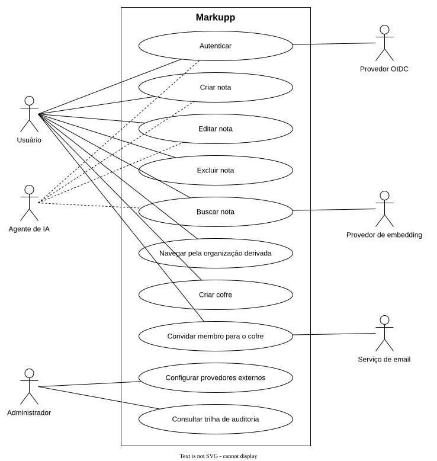

# Casos de uso

Usuário e agente de IA são o mesmo ator perante o sistema. O diagrama diz isso pela
generalização. Os dois são Cliente, e todo caso de uso aberto a um está aberto ao outro.

O que muda é a porta de entrada. Cliente que fala REST entra pela API, cliente que fala MCP
entra pelo servidor MCP, e as duas portas expõem o mesmo conjunto de operações.

O administrador aparece à parte porque não escreve nota, configura a instalação.

Provedor OIDC, provedor de embedding e serviço de email aparecem à direita porque o sistema
depende deles para completar um caso de uso, e não porque alguém os opera.

## Autenticar

Ator: cliente.

O cliente apresenta credencial local ou é redirecionado ao provedor OIDC habilitado. No
retorno, o servidor liga o identificador do provedor a uma conta de chave estável e abre a
sessão. Conta que ainda não existe só é criada se o auto-registro estiver ligado, e ele vem
desligado.

## Criar nota

Ator: cliente.

O cliente envia caminho e conteúdo para um cofre de que é membro. O servidor grava a nota,
registra a operação na trilha de auditoria na mesma transação e avança o cursor de revisão, que
é o que o indexador observa. Caminho já ocupado dentro do cofre rejeita a criação.

## Editar nota

Ator: cliente.

O cliente envia o conteúdo novo junto da versão que leu. Se a nota mudou desde então, o
servidor recusa e devolve conflito, e cabe ao cliente decidir entre reler ou forçar a
sobrescrita. Cada gravação aceita reindexa a nota.

## Excluir nota

Ator: cliente.

O cliente remove a nota de um cofre de que é membro. O dado derivado da nota sai do plano de
recuperação na reindexação seguinte.

## Buscar nota

Ator: cliente.

A consulta corre em dois ramos. O léxico usa o índice de texto e devolve relevância e trecho
destacado. O semântico transforma a consulta em vetor pelo provedor de embedding e busca por
proximidade. O resultado combina os dois e cobre só os cofres de que o cliente é membro. Sem
provedor de embedding configurado, sobra o ramo léxico.

## Navegar pela organização derivada

Ator: cliente.

O cliente percorre a base pelas ligações e pelos agrupamentos que o servidor calculou, em vez
da árvore de caminhos. A visão é por cofre, então tema que atravessa cofres não aparece
agrupado.

## Criar cofre

Ator: cliente.

Qualquer cliente autenticado que não é viewer no tenant cria um cofre e vira membro dele. O
cofre nasce vazio, com namespace de caminho próprio, e o nome não precisa ser único.

## Renomear cofre

Ator: cliente.

Um membro que não é viewer troca o nome do cofre. Caminhos e notas não mudam.

## Apagar cofre

Ator: cliente.

Um membro que não é viewer apaga o cofre, e as notas e o dado derivado delas vão junto. Vale
também para o último cofre da conta, que passa a não ter nenhum.

## Adicionar membro ao cofre

Ator: cliente.

Um membro que não é viewer escolhe, numa lista das contas do tenant, quem entra no cofre. Só
entra conta que já tem vínculo com o tenant; quem é de fora entra antes pelo convite do
tenant. O novo membro lê as notas do cofre e, se não for viewer, escreve e gerencia o cofre
como qualquer outro, inclusive removendo quem o criou.

## Sair do cofre

Ator: cliente.

Qualquer membro, viewer inclusive, remove a si mesmo do cofre e deixa de ver as notas dele.
O cofre pode acabar sem nenhum membro.

## Configurar provedores externos

Ator: administrador.

O administrador liga e desliga provedores de autenticação, de email e de embedding na
configuração da instalação. Trocar o modelo de embedding obriga reconstruir a tabela de
vetores, porque vetores de modelos diferentes não se comparam.

## Consultar trilha de auditoria

Ator: administrador.

O administrador lê as operações críticas registradas, com tenant, ator, ação, alvo, momento
e resultado. A trilha só aceita inserção, então não existe caso de uso de editar ou apagar
registro.
