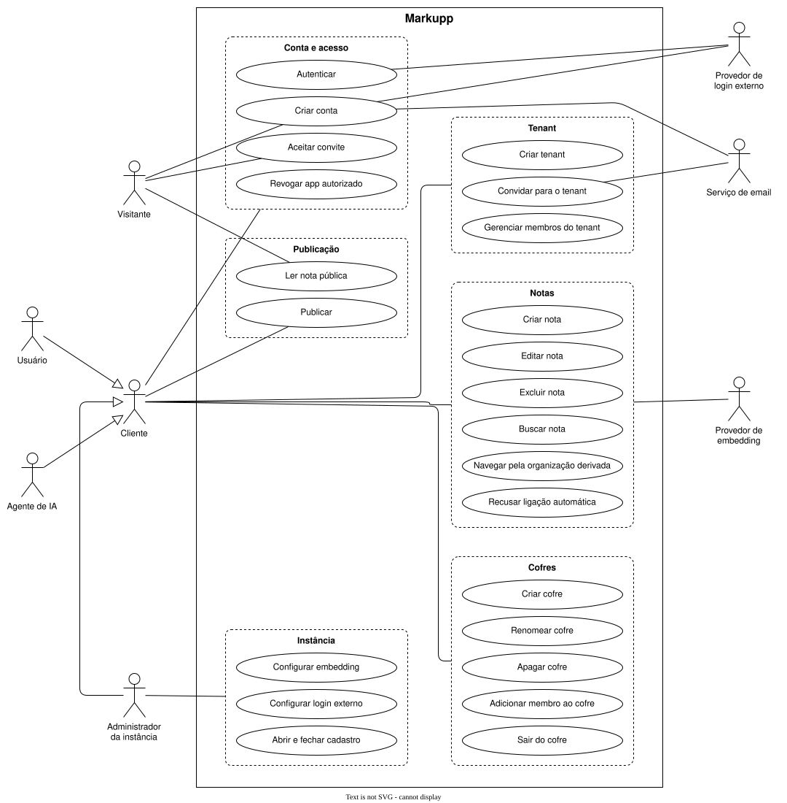

# Casos de uso

Usuário e agente de IA são o mesmo ator perante o sistema. O diagrama diz isso pela
generalização. Os dois são Cliente, e todo caso de uso aberto a um está aberto ao outro.

O que muda é a porta de entrada. Cliente que fala REST entra pela API, cliente que fala MCP
entra pelo servidor MCP, que é cliente da mesma API. O painel web também é cliente dela.

O administrador da instância é um Cliente cuja conta, de email verificado, quem hospeda listou
em `MARKUPP_INSTANCE_ADMINS`. Ele cuida do que vale para a instância inteira.

O visitante é quem chega sem sessão: lê o que está publicado, cria conta ou aceita um convite.

Provedor de login externo, provedor de embedding e serviço de email aparecem à direita porque
o sistema depende deles para completar um caso de uso, e não porque alguém os opera.

## Autenticar

Ator: cliente.

O cliente entra com email e senha ou pelo provedor de login externo ligado na instância. O
login só entra em conta que já existe, e a identidade externa só entra na conta a que já está
vinculada. O vínculo nasce nas configurações da conta, com a sessão aberta, nunca pelo email
que o provedor informa.

## Criar conta

Ator: visitante.

O visitante se cadastra por email e senha ou por um provedor de login externo, e o servidor
cria a conta e abre a sessão. A primeira conta da instância vira owner do tenant inicial. As
outras só nascem pelo método de cadastro que estiver aberto, e chegam sem tenant; sem email
provado e com SMTP, recebem o email de verificação.

## Aceitar convite

Ator: visitante ou cliente.

Quem recebeu o convite entra no tenant com o papel dele. O visitante apresenta o token do
convite e escolhe a senha, e a conta nasce com o email do convite, mesmo com o cadastro
fechado. A conta que já existe aceita ou recusa o convite pelo painel, depois de verificar o
email. Ao entrar no tenant, a conta ganha um cofre.

## Criar nota

Ator: cliente.

O cliente envia caminho e conteúdo para um cofre de que é membro. O servidor grava a nota e a
põe na fila dos dois indexadores na mesma transação. Caminho já ocupado dentro do cofre rejeita
a criação.

## Editar nota

Ator: cliente.

O cliente envia o conteúdo novo, e o caminho se for mudá-lo, junto da versão que leu. Se a nota
mudou desde então, o servidor recusa e devolve conflito, e cabe ao cliente decidir entre reler
ou forçar a sobrescrita. Cada gravação aceita volta para a fila de indexação.

## Excluir nota

Ator: cliente.

O cliente remove a nota de um cofre de que é membro. O dado derivado da nota sai junto, e o
indexador refaz o grafo e os agrupamentos do cofre.

## Buscar nota

Ator: cliente.

A busca é léxica: usa o índice de texto, pesa mais o título e devolve relevância e trecho
destacado. Cobre só os cofres de que o cliente é membro, ou um deles, se o cliente pedir.

A busca pelo sentido, com os mesmos vetores da ligação por sentido, está planejada e ainda não
existe.

## Navegar pela organização derivada

Ator: cliente.

O cliente percorre a base pelo grafo, pelas ligações, menções, sugestões e comunidades que o
servidor calculou, em vez da árvore de caminhos. A visão é por cofre, então tema que atravessa
cofres não aparece agrupado.

## Recusar ligação automática

Ator: cliente.

Um membro que não é viewer recusa a ligação automática entre duas notas do cofre, e o servidor
não volta a criar ligação automática entre elas, de nenhum tipo. A lista das recusas fica nas
configurações do cofre, onde a recusa se desfaz.

## Criar cofre

Ator: cliente.

Qualquer cliente autenticado que não é viewer no tenant cria um cofre e vira membro dele. O
cofre nasce vazio, com namespace de caminho próprio, e o nome não precisa ser único.

## Renomear cofre

Ator: cliente.

Um membro que não é viewer troca o nome do cofre. Caminhos e notas não mudam.

## Apagar cofre

Ator: cliente.

Um membro que não é viewer apaga o cofre, e as notas e o dado derivado delas vão junto. Vale
também para o último cofre da conta, que passa a não ter nenhum.

## Adicionar membro ao cofre

Ator: cliente.

Um membro que não é viewer escolhe, numa lista das contas do tenant, quem entra no cofre. Só
entra conta que já tem vínculo com o tenant; quem é de fora entra antes pelo convite. O novo
membro lê as notas do cofre e, se não for viewer, escreve e gerencia o cofre como qualquer
outro, inclusive removendo quem o criou.

## Sair do cofre

Ator: cliente.

Qualquer membro, viewer inclusive, remove a si mesmo do cofre e deixa de ver as notas dele.
O cofre pode acabar sem nenhum membro.

## Publicar

Ator: cliente.

O cliente torna pública uma nota, uma pasta ou o cofre inteiro, digitando o nome do alvo para
confirmar. Pasta e cofre publicados incluem as notas que entrarem neles depois. Cada nota
pública ganha um endereço `/p/` com id próprio. A página sai fora dos buscadores, e quem
publica pode liberar a indexação por publicação. Despublicar invalida o endereço.

## Ler nota pública

Ator: visitante.

Qualquer pessoa ou agente lê a nota pública pelo endereço dela, sem conta, e busca e navega
pelo grafo do que está publicado junto. Ninguém escreve por esse caminho.

## Criar tenant

Ator: cliente.

Qualquer conta cria um tenant e vira owner dele, com um cofre inicial.

## Convidar para o tenant

Ator: cliente.

Owner ou admin convida um email, com papel no máximo igual ao seu e validade de uma semana.
Com SMTP, o convite sai por email; sem ele, a API devolve o token para ser repassado à mão.
O convite pendente pode ser revogado.

## Gerenciar membros do tenant

Ator: cliente.

Owner ou admin troca o papel de um membro ou o remove do tenant, sem mexer em quem tem papel
acima do seu e sem deixar o tenant sem owner. Só o owner apaga o tenant.

## Revogar app autorizado

Ator: cliente.

A conta vê os clientes OAuth a que deu autorização, como o servidor MCP, e revoga qualquer um.
O cliente revogado perde o acesso em nome dela.

## Configurar embedding

Ator: administrador da instância.

O administrador escolhe o provedor de embedding pelo painel, pela API ou pelo MCP. Trocar de
provedor ou de modelo refaz os vetores de todas as notas, porque vetores de modelos diferentes
não se comparam. Se quem hospeda fixou o provedor nas variáveis de ambiente, vale a variável e
a escolha fica travada. Detalhes em [embedding.md](embedding.md).

## Configurar login externo

Ator: administrador da instância.

O administrador cadastra, liga, desliga e apaga provedores de login externo, OpenID Connect ou
GitHub, pelo painel, pela API ou pelo MCP. Apagar um provedor apaga os vínculos das contas com
ele. Com `MARKUPP_LOGIN_PROVIDERS` definida, vale a lista de quem hospeda e a do banco fica
travada.

## Abrir e fechar cadastro

Ator: administrador da instância.

O administrador abre ou fecha o cadastro de cada método, email e senha e cada provedor de login
externo, pelo painel ou pela API. Fechar o cadastro não fecha o login de quem já tem conta. A
variável de cada método, quando definida, vence e trava o interruptor dele.
