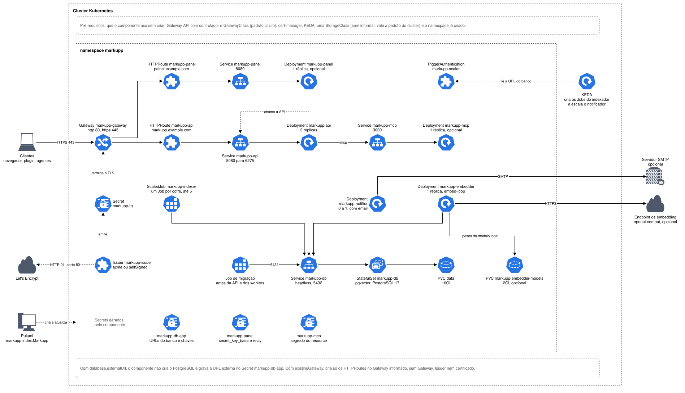

# Diagrama de implantação

Diagrama de implantação no estilo C4, com os ícones do Kubernetes. Mostra o que o componente
Pulumi de `deploy/pulumi` cria num cluster e o que ele usa sem criar. Os nomes saem do nome do
componente, aqui markupp, e os domínios são de exemplo. O desenho por serviço está nos
[diagramas de blocos](diagramas-de-blocos.md), e as opções do componente em [DEPLOY.md](DEPLOY.md).

## O que o cluster precisa ter

Gateway API com um controlador e uma GatewayClass (padrão cilium), cert-manager, KEDA e uma
StorageClass. Sem informar a StorageClass, os volumes usam a padrão do cluster. O namespace já
precisa existir: tudo o que o componente cria fica dentro dele, sem recurso no nível do cluster.

Sem KEDA, a instalação sobe sem o indexador e sem email (`indexer: {enabled: false}` e sem o
bloco `email`).

## Entrada

O cliente chega por HTTPS no host da API, markupp.example.com no desenho. O Gateway termina o
TLS e o HTTPRoute markupp-api manda o tráfego para o Service da API, que encaminha a porta 8080
para a 6275 do contêiner. O servidor MCP não tem rota própria: atende em /mcp no host da API, e
a API encaminha o pedido ao Service markupp-mcp.

Com o painel ligado, ele ganha um host próprio, painel.example.com no desenho, com outro
listener no Gateway e o HTTPRoute markupp-panel. O painel chama a API pelo Service, do lado do
servidor.

O certificado vem do Issuer markupp-issuer. Com acme, o padrão, ele valida o domínio no Let's
Encrypt pelo desafio HTTP-01, na porta 80 do próprio Gateway. Com selfSigned, para cluster sem
domínio público, o certificado é autoassinado.

Em cluster onde outro Gateway já ocupa as portas 80 e 443, `existingGateway` pendura os
HTTPRoutes nesse Gateway. Aí o componente não cria Gateway nem Issuer, e o certificado fica com
quem administra o Gateway.

## Serviços

A API roda num Deployment de duas réplicas, o padrão de `apiReplicas`. O painel e o servidor MCP
são opcionais e rodam com uma réplica cada, porque guardam estado na memória do processo: a
renovação do token no painel, as sessões no MCP.

O indexador é um ScaledJob do KEDA. O KEDA consulta o banco a cada 30 segundos e cria um Job por
cofre com nota pendente, até cinco ao mesmo tempo, e nenhum quando não há o que indexar. Com
email configurado, o notificador sobe num Deployment que um ScaledObject leva de zero a uma
réplica conforme a fila de emails. As duas consultas usam o TriggerAuthentication
markupp-scaler, com a URL de um papel do banco que só conta pendências.

O embedder, indexador de embedding, roda sempre, num Deployment de uma réplica em laço. Os pesos
do modelo local ficam num volume de 2Gi; com `embedderModelVolume: false` eles vão para um
emptyDir e são baixados de novo a cada subida do pod. Com o provedor openai-compat, o embedder
chama o endpoint configurado.

## Banco

O PostgreSQL, com o pgvector, roda num StatefulSet de uma instância, atrás do Service headless
markupp-db, com um volume de 10Gi (o padrão de `database.size`). Sem failover: se o nó do banco
cair, a API fica sem banco até o pod subir em outro nó. O componente não faz backup do banco.

Com `database.externalUrl`, o componente não cria o PostgreSQL e grava a URL externa no Secret
markupp-db-app.

## Segredos

O componente gera os segredos com o Pulumi e os grava em Secrets do namespace. O markupp-db-app
guarda a senha e a URL do banco, a URL do papel do scaler, o segredo do JWT, a
MARKUPP_SECRET_KEY e, com email, a URL do SMTP. O markupp-panel guarda a secret_key_base e o
segredo de relay do painel, e o markupp-mcp o segredo do resource do servidor MCP.

## Ordem de subida

O Pulumi cria o banco, roda o Job de migração e só depois cria ou atualiza a API, o indexador, o
notificador e o embedder. O Job tenta de novo até o PostgreSQL aceitar conexão. O schema muda
antes de qualquer réplica nova atender.

## Na stack dev

A stack dev, em `deploy/stacks`, sobe o mesmo componente num cluster kind com os pré-requisitos
acima, no CI e no `make kind-up`. Mudam três coisas: o certificado é autoassinado, o volume usa
a StorageClass standard do kind e a API tem uma réplica.
