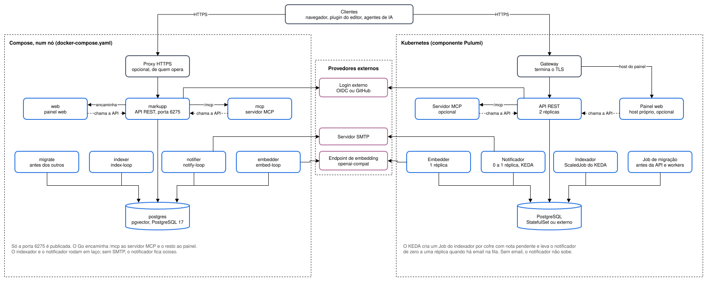

# Diagramas de blocos

O markupp roda como vários processos com ciclo de vida próprio (ADR-0002), divididos por perfil
de recurso, não por entidade de domínio (ADR-0028). Nota, cofre, conta e busca não são serviços:
compartilham banco e caminho de requisição. Dividir por entidade transformaria a escrita de uma
nota em várias chamadas de rede com transação distribuída.

São quatro imagens. A do servidor, em Go, roda a API, a migração, o indexador e o notificador,
cada um com o seu comando. O embedder é o mesmo servidor com o ONNX Runtime, numa imagem à parte.
O painel, em Rails, e o servidor MCP, em TypeScript, têm imagem própria. O compose e o componente
Pulumi usam as mesmas imagens.

## Clientes

Cliente é tudo que consome o markupp pela API REST ou pelo servidor MCP: o painel web, o
[plugin do Obsidian](https://github.com/markupp-labs/obsidian-markupp-plugin), agentes de IA e o
que vier depois. Nenhum toca o banco, nenhum tem rota privilegiada, e todos enxergam o mesmo
conjunto de operações.

O navegador consome o painel, não a API. Quem chama a API é o painel, do lado do servidor.

## Serviços

A **API REST** é o servidor Go. Por ela entra e sai todo conteúdo, e ela também é o authorization
server do OAuth (ADR-0046).

O **painel web** é a interface do usuário, em Rails com Hotwire (ADR-0031). É cliente da API como
qualquer outro e não alcança o banco.

O **servidor MCP** é a porta MCP dos mesmos clientes, com o mesmo conjunto de operações, e chama a
API para tudo (ADR-0045). Atende em /mcp na origem da API, que encaminha o pedido a ele.

O **indexador** processa os cofres com nota pendente e grava o que deriva das notas (ADR-0033).
Gasta CPU em rajada e não carrega modelo.

O **embedder** é o indexador de embedding, da ligação por sentido (ADR-0053). Transforma as notas
em vetores com o modelo local ou com um endpoint openai-compat, e fica ocioso com o provedor
none.

O **notificador** entrega os emails da fila por SMTP, com repetição, fora do caminho da
requisição.

A **migração** aplica o schema e termina. Roda antes dos serviços que leem o banco.

## Dados

Um PostgreSQL só, com o pgvector para os vetores (ADR-0055). A API, a migração, o indexador, o
embedder e o notificador falam com ele. O painel e o servidor MCP ficam de fora, porque consomem a
API. São serviços no sentido de implantação e escala independentes, não no de banco por serviço,
e o isolamento entre eles é de processo e de escala, não de dado.

O preço é acoplamento pelo schema. Mudança de coluna coordena os cinco, em expand e contract, e
nenhum deles evolui o modelo de dados por conta própria.

## Provedores externos

Todos opcionais e trocáveis por configuração: o login externo, por OIDC ou GitHub, que a API
consulta (ADR-0054); o endpoint de embedding, que o embedder chama quando o provedor é
openai-compat; e o servidor SMTP do notificador. Sem SMTP, o convite devolve o token para ser
repassado à mão.

## Compose e Kubernetes

No compose, num nó só, a API é a única porta publicada, a 6275 (ADR-0058). Ela encaminha /mcp ao
servidor MCP e todo o resto ao painel, então painel, API e MCP dividem uma origem. O TLS fica com
um proxy HTTPS na frente, se quem opera puser um. O indexador e o notificador rodam em laço, e o
notificador fica ocioso sem SMTP.

No Kubernetes, pelo componente Pulumi, o TLS termina no Gateway (ADR-0027). O painel ganha um
host próprio e o MCP continua em /mcp no host da API. A API roda com duas réplicas por padrão. O
KEDA cria um Job do indexador por cofre com nota pendente e leva o notificador de zero a uma
réplica conforme a fila (ADR-0032); sem email configurado, o notificador nem sobe. O embedder
roda em laço nos dois. O banco pode ser o PostgreSQL que o componente sobe no namespace ou um
externo. O que o componente cria está no [diagrama de implantação](diagrama-de-implantacao.md).

O ADR-0028 lista também um plano de controle para provisionar tenants, que não tem código. Hoje
qualquer conta cria tenant pela API.
