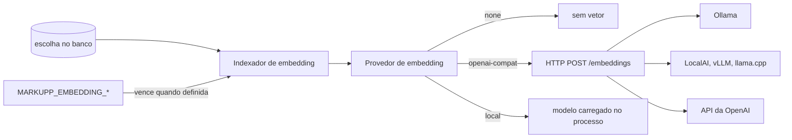

# Embedding

O provedor de embedding transforma cada nota num vetor para a ligação por sentido
([ADR-0053](adrs/ADR-0053-ligacoes-automaticas.md)). A razão de ser plugável está no ADR-0029.

## Escolha rápida

| Provedor | Onde o modelo roda | Custo | Quando usar |
| --- | --- | --- | --- |
| `none` | nenhum | zero | Padrão do self-host. Busca léxica e grafo funcionam sem vetor |
| `local` | dentro do indexador de embedding | elétrico | Self-host sem nenhum serviço externo, nem container extra |
| `openai-compat` | máquina de quem hospeda | elétrico | Self-host que já roda Ollama, LocalAI ou vLLM |
| `openai-compat` | API da OpenAI | por token | Quem já tem chave e não quer rodar modelo |
| `bedrock` | AWS | por token | Planejado, ainda não implementado |

## Onde se escolhe

O administrador da instância escolhe no painel, em Settings, grupo Instance, seção Embedding, ou
pela API em `PUT /v1/instance/embedding`, ou pela ferramenta MCP `set_embedding_provider`. Quem
administra é a conta de email verificado listada em `MARKUPP_INSTANCE_ADMINS`.
O administrador pode apontar a URL do endpoint remoto para endereços dentro da rede de quem
hospeda, como um Ollama no mesmo compose ou cluster, e o indexador de embedding faz os pedidos
de lá. Liste como administrador só quem pode ter esse alcance.

Quem hospeda pode fixar o provedor nas variáveis `MARKUPP_EMBEDDING_*` do indexador de
embedding. Com `MARKUPP_EMBEDDING_PROVIDER` definida, mesmo como `none`, ela vence, e o painel
mostra a escolha travada ([ADR-0057](adrs/ADR-0057-provedor-de-embedding-no-banco.md)).

## Como funciona



O indexador relê a escolha a cada intervalo e troca de provedor sem reiniciar. Ele grava no
banco o estado do modelo, que o painel mostra: baixando, pronto ou erro.

## none

Padrão. Busca léxica (ADR-0017) e grafo de ligações continuam completos, sem a ligação por
sentido.

## openai-compat com Ollama

Serviço no compose:

```yaml
  ollama:
    image: ollama/ollama
    volumes:
      - ollama_models:/root/.ollama
```

Baixe o modelo uma vez:

```bash
docker compose exec ollama ollama pull nomic-embed-text
```

No painel, escolha o endpoint compatível com a OpenAI, com a URL `http://ollama:11434/v1` e o
modelo `nomic-embed-text`. Pelas variáveis:

```bash
MARKUPP_EMBEDDING_PROVIDER=openai-compat
MARKUPP_EMBEDDING_URL=http://ollama:11434/v1
MARKUPP_EMBEDDING_MODEL=nomic-embed-text
```

## openai-compat com a API da OpenAI

URL `https://api.openai.com/v1`, modelo `text-embedding-3-small` e a chave da API. A chave dada
no painel fica no banco cifrada com a `MARKUPP_SECRET_KEY`, e a API nunca a devolve; sem essa
variável, a chave de cifra fica no próprio banco, e uma cópia do banco revela a chave.

## local

Roda o modelo fixo do ADR-0056 dentro do processo do indexador de embedding, sem container nem
serviço externo, e só na imagem `markupp-embedder`, que traz o ONNX Runtime. Ao ligar, baixa os
pesos para `MARKUPP_EMBEDDING_MODEL_DIR`, numa revisão fixa e com sha256 conferido. Se o
download falhar, gravar a mesma escolha de novo tenta outra vez.

## Trocar de modelo obriga reindexar

Vetor de modelo diferente não é comparável: cada modelo produz um espaço próprio, e a dimensão
muda. O modelo ativo fica registrado junto dos vetores. Ao trocar de provedor ou de modelo, o
indexador apaga os vetores e refaz os de todas as notas. Isso é seguro porque vetor é dado
derivado (ADR-0012), mas custa uma passada de embedding sobre todas as notas, o que num
provedor pago é custo por chamada.
