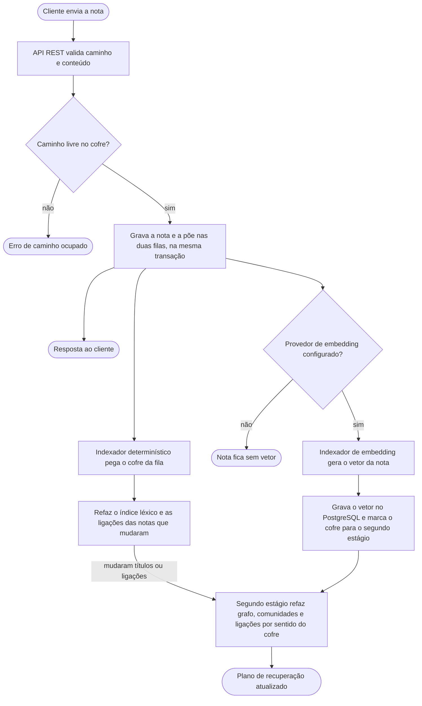
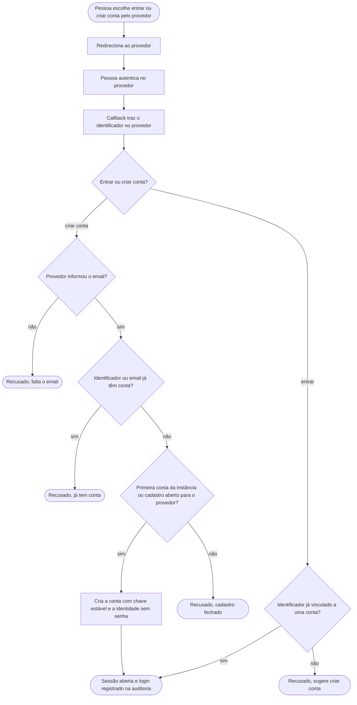
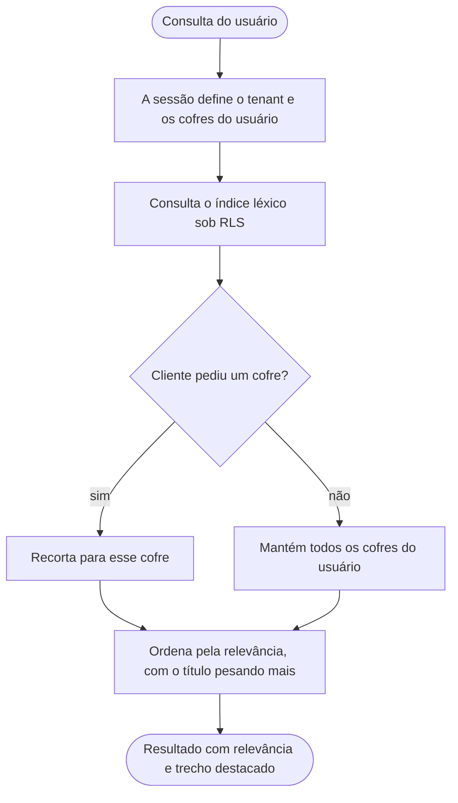
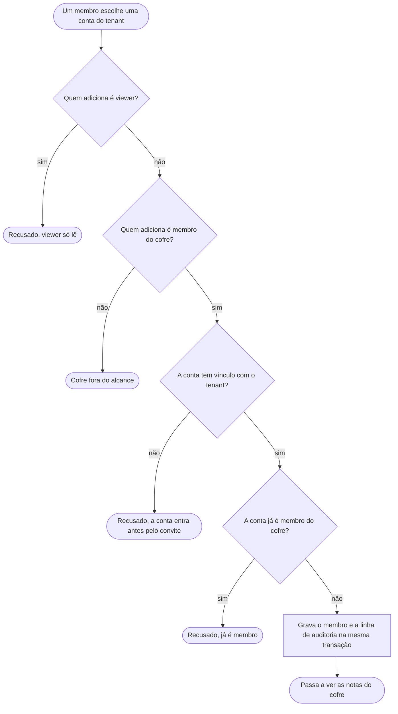

# Fluxogramas

Quatro fluxos, escolhidos porque cada um atravessa uma fronteira que os outros documentos
descrevem parada: a separação entre plano de registro e plano de recuperação, a troca com o
provedor de login externo, o recorte da busca pelo banco e a entrada num cofre, que depende do
vínculo com o tenant.

## Indexação de nota

A gravação e a indexação se separam no momento em que a nota entra. A resposta ao cliente
sai assim que a transação fecha, e os dois indexadores seguem por conta própria, cada um com
sua fila no banco. No compose, eles rodam em laço; no Kubernetes, o componente Pulumi sobe um
Job por cofre pendente.

Isso torna o índice eventualmente consistente por escolha. Uma nota recém-salva pode não
aparecer na busca no segundo seguinte, e a alternativa seria prender a latência da escrita ao
tempo de gerar vetores.

Sem provedor de embedding, a ligação por sentido não acontece, e o resto do plano de
recuperação fica completo do mesmo jeito.

## Login e cadastro por provedor externo

O login e o cadastro terminam na mesma abertura de sessão do login por senha. A diferença
entre instâncias é qual provedor está ligado, não qual código roda.

Autenticar no provedor prova identidade e não concede entrada. Quem não tem a identidade
vinculada não entra pelo login, e só ganha conta pelo cadastro quando o método está aberto.
Ninguém é vinculado a uma conta existente pelo email que o provedor informa; o vínculo nasce
nas configurações da conta, com a sessão aberta.

## Busca

A consulta corre sobre a sessão, que já carrega o tenant e os cofres do usuário. Isso dispensa
filtro de acesso escrito em cada consulta: a política de linha do banco recorta o resultado
antes da ordenação.

## Adicionar membro ao cofre

Não há email nem aceite: a conta já faz parte do tenant e entra no cofre na hora. Quem é de
fora passa antes pelo convite, que é onde o email acontece.

As verificações acontecem no serviço e de novo na política de linha do banco, então uma falha
no serviço sozinha não basta para gravar o membro.
